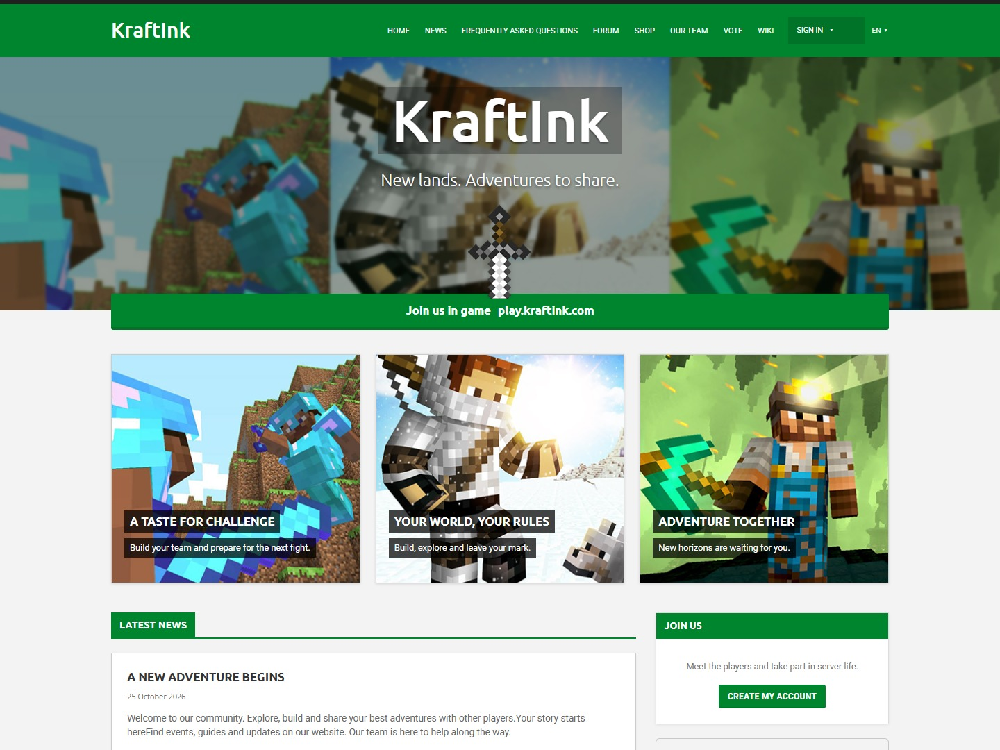

# Unruly for KraftInk

Unruly gives your KraftInk site a classic Minecraft look. Its homepage features an illustrated banner, an interactive sword, showcase cards for your server and a ribbon where players can copy the public server address.

## Set up Unruly

1. In KraftInk, open **Administration → Themes** and install Unruly from the catalogue or upload its ready-to-install ZIP.
2. Click **Use for website**.
3. Open **Configure** to change the accent colour, banner, logo and showcases. You can also add links to your launcher and Discord server. Leave the banner title and subtitle blank to use your KraftInk homepage text.

[KraftInk](https://kraftink.com/en) · [Theme installation guide](https://kraftink.com/en/documentation/extensions-catalogue) · [Discord](https://discord.kraftink.com)

## Licence and credits

Unruly is adapted from the [MineWeb Unruly theme](https://github.com/MineWeb/Theme-Unruly) by Orphevs and Eywek and distributed under GPL-3.0-or-later. Include these credits and the [full licence](LICENSE) when redistributing the theme.
